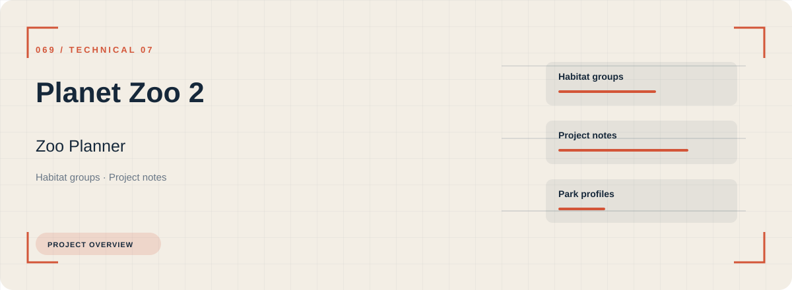
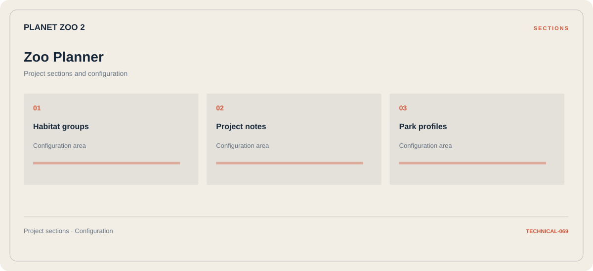

# 🎮 Planet Zoo 2 Zoo Planner

**Habitat groups · Project notes · Park profiles**

## ⚡ Features

Habitat groups, project notes, and park profiles form the core of Planet Zoo 2 Zoo Planner. Related configuration is grouped by task rather than collected in an undifferentiated list.

### ⚙️ Habitat groups

A dedicated section for habitat groups and the configuration details associated with that area.

### 🧩 Project notes

A dedicated section for project notes and the configuration details associated with that area.

### ⌨️ Park profiles

Related settings collected into named groups for a clearer configuration workflow.

## 🖥️ Project navigation

## 📥 Download

The button and cover open the project's download page. Use the information supplied with the downloaded package for installation and release-specific requirements.

## 📚 Project documentation

- [Feature reference](docs/FEATURES.md)
- [Download information](docs/DOWNLOAD.md)
- [Project page](index.html)

---

Planet Zoo 2 Zoo Planner · Program documentation and download information.
